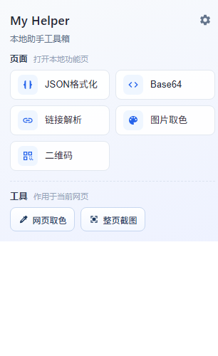
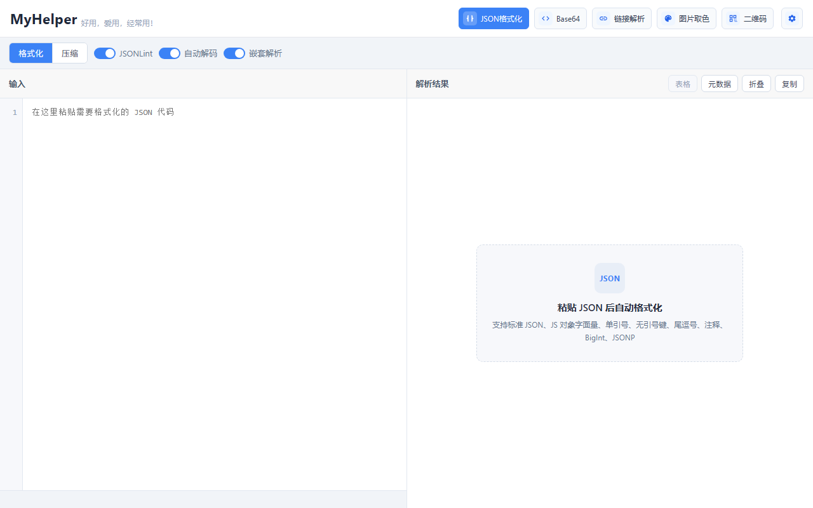
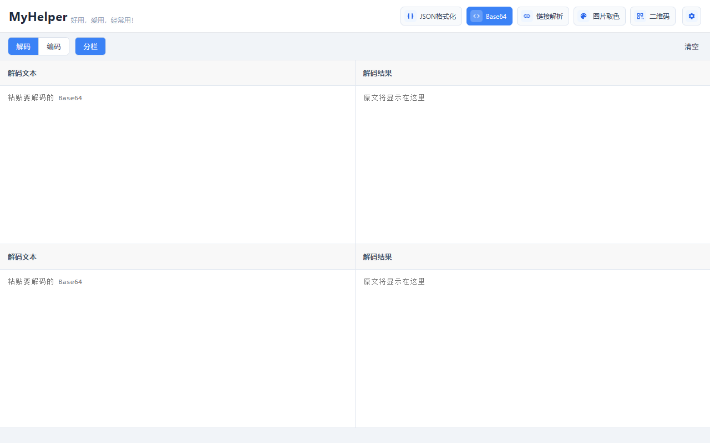
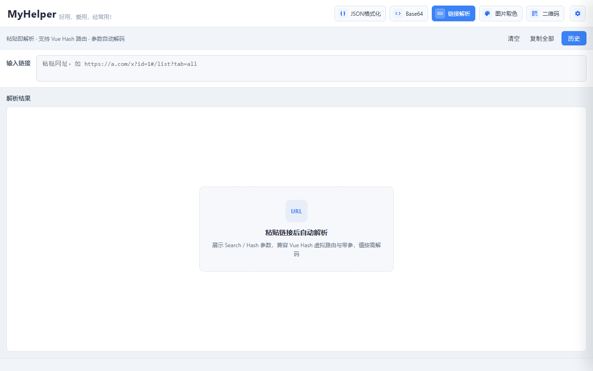
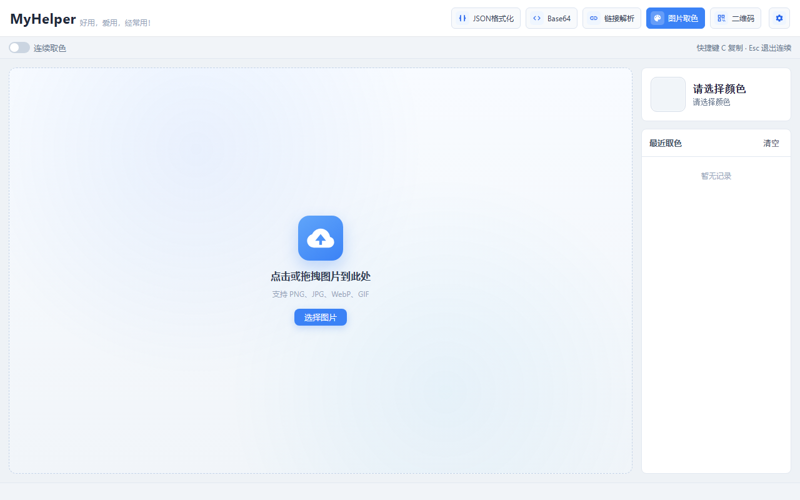
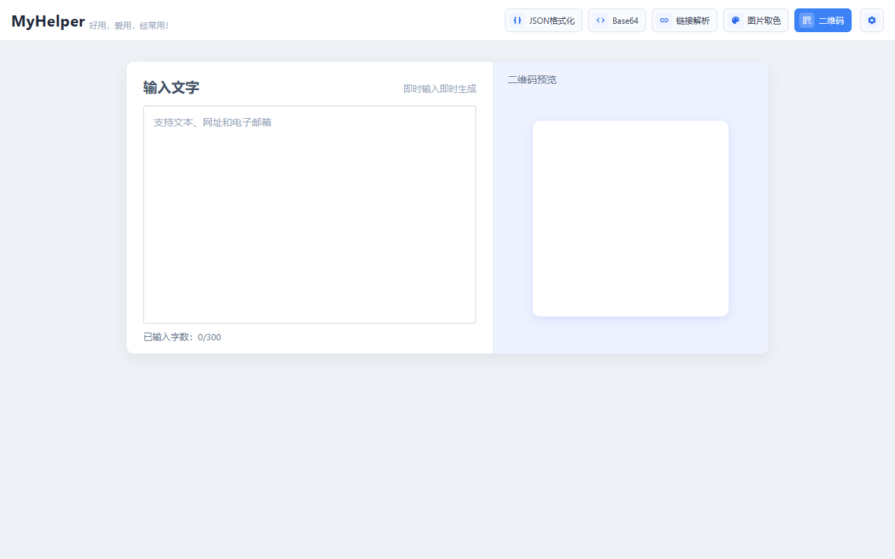
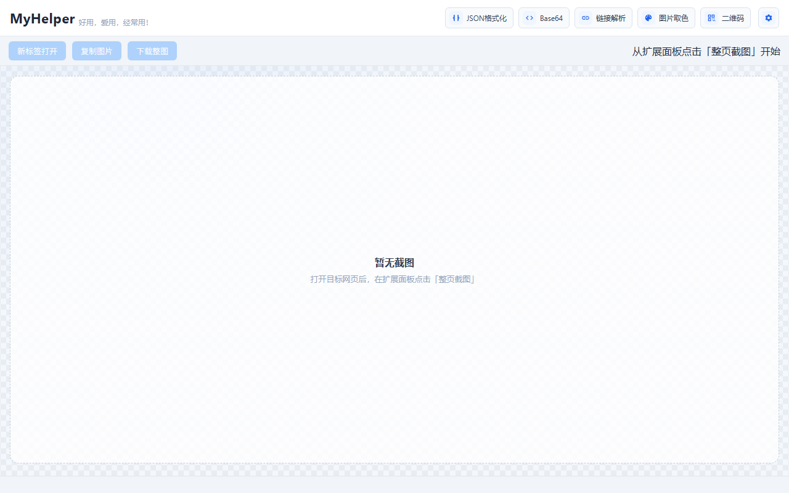
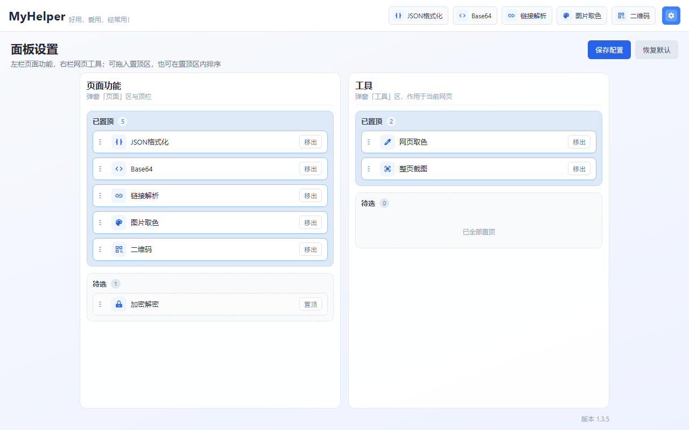

# chrome插件-MyHelper


`MyHelper` 是一个本地即时可用的 Chrome 助手扩展（Manifest V3），把前端日常高频的小工具聚合到一个插件里：JSON 格式化、Base64、链接解析、取色、整页截图、二维码……点开即用，配置仅存本地。

项目地址：[`my-helper`](https://github.com/liwangying55555/my-helper)

## 初衷

项目数据多少总带一点涉密性，而目前线上的各种 JSON 格式化、编解码工具，不是广告满天飞，就是总让人担心有后门，存在数据泄露的风险。

于是干脆自己造一个轮子——所有工具本地运行，所有配置仅存本地，不向任何服务器发送一份数据。造轮子虽然辛苦，但好处是：**放心、安心、好用**。

## 功能一览

| 工具 | 说明 |
| ------ | ------ |
| JSON 格式化 | 格式化 / 压缩，树形折叠，表格与元数据视图 |
| Base64 | 编解码，支持上下分栏（最多 4 栏） |
| 链接解析 | 解析 origin、pathname、Search / Hash（兼容 Vue Hash 路由） |
| 图片取色 | 工具页图片点选，连续取色 / 放大镜 / 历史 |
| 网页取色 | 面板一键网页截屏取色 |
| 整页截图 | 内层滚动 / 懒加载等待 / JPG 输出；超长页拆多图 |
| 二维码 | 文本即时生成二维码 |
| 设置 | 「页面功能」与「工具」分别置顶、排序，配置仅存本地 |

## 安装

扩展基于 Vite + `@crxjs/vite-plugin` 构建，克隆源码后本地构建即可：

```shell
yarn install   # 安装依赖
yarn build     # 输出压缩混淆后的 dist/
```

随后打开 `chrome://extensions/`，开启右上角的「开发者模式」，点击「加载已解压的扩展程序」，选择 `dist/` 目录即可。

:::tip
注意：源码根目录不可直接加载（background 使用 ESM import，需经构建处理），请加载构建后的 `dist/` 目录。
:::

安装完成后，浏览器右上角的扩展面板长这样，上面是「页面功能」，下面是作用于当前网页的「工具」：



## 功能截图

### 1、JSON 格式化

粘贴即自动格式化，支持格式化 / 压缩切换，JSONLint 校验、自动解码、嵌套解析，结果支持树形折叠、表格视图与元数据视图，还能一键复制。



### 2、Base64

常规编解码，支持上下分栏（最多 4 栏），多段内容并行处理，互不干扰。



### 3、链接解析

粘贴链接后自动解析，展示 origin、pathname、Search / Hash 参数，兼容 Vue Hash 虚拟路由与带参 hash，告别肉眼拆 URL。



### 4、图片取色

点选或拖入图片即可取色，支持连续取色、放大镜精确拾取，颜色历史随时回看。



### 5、二维码

输入文字、网址或电子邮箱，即时生成二维码，右侧实时预览。



### 6、整页截图

从扩展面板对目标网页一键触发，支持内层滚动容器与懒加载等待，输出 JPG；超长页面自动拆分为多图，结果页支持新标签打开、复制图片与下载（`Ctrl` / `⌘` + `S`）。



### 7、设置

「页面功能」与「工具」分别管理：拖入置顶区、在置顶区内排序，面板展示顺序完全由自己掌控，配置仅存本地。



## 一些技术细节

- 基于 Manifest V3，Service Worker 仅用于初始化本地配置与动态注入脚本，不做任何网络上报；
- 权限最小化：`storage`（配置 / 历史）、`activeTab` + `scripting`（网页取色 / 整页截图），仅此而已；
- 工程化构建：Vite + `@crxjs/vite-plugin`，入口脚本打包压缩 hash 化，共享逻辑提取公共 chunk，`content/` 注入脚本保持原路径输出，`yarn zip` 一键出分发包；
- 新增工具只需在 `shared/tool_list.js` 注册，并在 `pages/` 下增加对应页面，面板 / 设置 / 顶栏自动同步。

## 最后

作为一个纯纯的切图仔，把常用的零散小工具收进一个自己的口袋里，确实是一件很爽的事情。

有兴趣可以移步 [my-helper](https://github.com/liwangying55555/my-helper) 看看，欢迎交流。